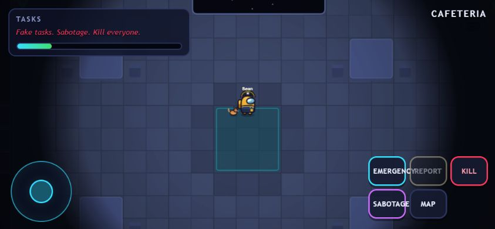
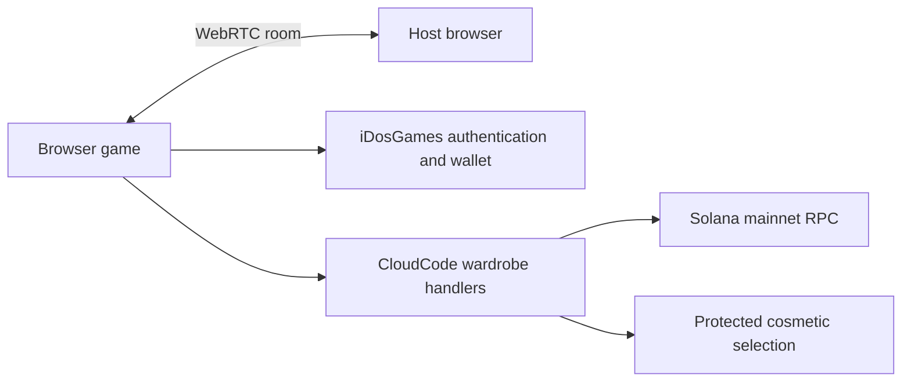

# Outcast — Trust No One

> Browser social deduction with online rooms, mobile controls, and Solana token holding requirements for cosmetics.

[Live Demo](https://6kxnox5i.idos.games/) · [iDosGames](https://idosgames.com/app/6KXNOX5I/) · [Architecture](docs/architecture.md) · [Roadmap](docs/roadmap.md)



## Problem and Solution

Outcast lets friends play together in a browser without installing a client. One player hosts and shares a six-letter room code. Freeplay adds bots for solo play.

The wardrobe links the game to its OUTCAST community token. All character colors are free. Six of 28 hats, skins, and pets are free, the nearest whole-item allocation to 20%. Other items require holding 10,000, 20,000, 30,000, or 50,000 OUTCAST. Requirements were randomized once and are identical for everyone. Items are sorted from free to increasing thresholds.

## Why Solana

OUTCAST is an existing Solana mainnet token. The iDosGames server checks token accounts for the player's signature-verified linked wallet. Selecting clothing does not spend tokens or initiate a purchase or transfer.

| Token | Value |
|---|---|
| Symbol | OUTCAST |
| Network | Solana mainnet |
| Mint | `3BCFLiDS7HJBvo23r91dCDERJi8GgdqeQb8zfrXgidos` |
| Decimals | 6 |

## Tech Stack

| Layer | Technology |
|---|---|
| Game | HTML, CSS, JavaScript, Canvas 2D |
| Audio | Web Audio API |
| Multiplayer | PeerJS 1.5.4, WebRTC |
| Authentication and wallet | Official iDosGames core and wallet SDKs |
| Cosmetic access backend | iDosGames CloudCode, Solana JSON-RPC |
| Hosting | iDosGames |
| SDK bundle tooling | esbuild |

## Architecture



Gameplay is peer-to-peer and host-authoritative. Cosmetic access uses platform server handlers. See [architecture](docs/architecture.md), [API](docs/api.md), and [integration notes](integration/README.md).

## Quick Start

With Node.js and npm installed:

```sh
git clone https://github.com/ibrahi95/Outcast.git
cd Outcast
npx --yes http-server . -p 8409
```

Open `http://localhost:8409`. The shipped browser files need no build step. Live wallet access requires the linked iDosGames title and its published server handlers.

To rebuild the official SDK bridge:

```sh
cd integration
npm ci --ignore-scripts --legacy-peer-deps
cd ..
node integration/node_modules/esbuild/bin/esbuild integration/platform-bridge.js --bundle --format=iife --platform=browser --target=es2020 --minify --outfile=vendor/idos-platform.js
node integration/write-cloud-code.mjs
```

Keep the published cosmetic policy fixed. Running `create-catalog.mjs` replaces the randomized requirements for all players.

## Roadmap

- [x] Browser gameplay, rooms, bot Freeplay, maps, and modes.
- [x] OUTCAST mainnet token linked to the game.
- [x] Fixed wardrobe requirements and server holding checks.
- [x] Ascending wardrobe sorting.
- [x] Mobile joystick and responsive HUD, published in version 9.
- [ ] Confirm the complete signed-wallet flow with real holdings.
- [ ] Gather feedback from phone users and different network environments.

See [roadmap](docs/roadmap.md). Repository presentation follows the [Colosseum example by Marakaya](https://github.com/Marakaya/colosseum_example), adapted to the actual Outcast implementation.

## Gameplay and Features

A free, **serverless**, browser-based social deduction game in the spirit of Among Us —
with its own art, its own synthesized soundtrack, extra roles, new maps, and five game modes.

**No servers to pay for.** One player hosts a room right in their browser; everyone else joins
with a 6-letter code. Traffic flows peer-to-peer over WebRTC. The only outside help is a free
public signaling broker (PeerJS cloud) used for the initial handshake — after that, it's
player-to-player.

## Play it

1. Host the folder anywhere static files can live (all free):
   - **GitHub Pages** — push this folder to a repo → Settings → Pages → deploy from branch. Done.
   - **Netlify Drop** — drag the folder onto https://app.netlify.com/drop
   - **itch.io** — zip the folder, upload as an HTML game
   - Or locally: `npx http-server -p 8409` in this folder, then open http://localhost:8409
2. One player clicks **HOST GAME** and shares the room code.
3. Everyone else clicks **JOIN GAME** and enters the code. Up to 15 players.
4. No friends online? **FREEPLAY** fills the lobby with bots.

> Note: `file://` won't work (WebRTC needs a real origin). Any http(s) hosting is fine.
> Rarely, strict corporate/dorm NATs can block a peer connection — have a different player host.

## Modes

| Mode | The pitch |
|---|---|
| **Classic** | Tasks vs. impostors. Meetings, votes, sabotage, lies. |
| **Hide & Seek** | Impostor is revealed and hunting. No meetings. Finish tasks to burn the clock and survive. |
| **Outbreak** | Patient Zero doesn't kill — they *convert*. Finish the tasks before everyone is infected. |
| **Bomb Tag** | Free-for-all on the Meteor arena. Touch someone to pass the bomb. Don't be holding it. |
| **Task Sprint** | Pure race: same task list for everyone, first to finish wins. Watch for blackouts. |

## Roles

Crew: **Crewmate, Sheriff, Engineer, Scientist, Medic, Tracker** ·
Impostor: **Impostor, Shapeshifter, Phantom** · Neutral: **Jester** (get yourself voted out).

## Maps

**The Vessel** (classic ship bones) · **Lunar Outpost** · **Abyss Station** · **Meteor** (Bomb Tag arena)

## Controls

WASD / arrows to move · **E**/Space use · **R** report · **Q** kill · **F** vent/ability ·
**Tab/M** map · Enter chat. Touch: left-thumb joystick + on-screen buttons.

## Tech

Pure static HTML/JS/CSS — no build step. PeerJS 1.5.4 is bundled in `vendor/peerjs.min.js`.
All art is procedural canvas; all music and SFX are synthesized live with Web Audio.
